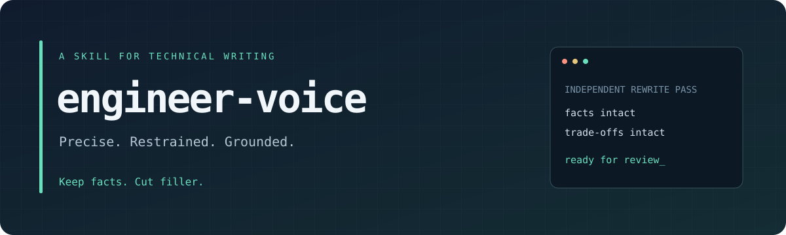

<div align="center">



# engineer-voice

**给技术文本做一次独立的改写。留下事实、判断和细节。**

去掉 AI 味，保留技术深度与专业性。

[安装](#安装) · [怎么用](#怎么用) · [改写对照](#改写对照) · [规则](SKILL.md) · [完整样例](examples.md)

`Agent Skills` · `Markdown` · `中文优先` · `无需运行时依赖`

</div>

---

当技术内容已经写完，却仍有“全面赋能”“完善的体系”“综上所述”，可以用 **engineer-voice** 再过一遍。它把注意力放在主体、动作、原因、条件与代价上，删去空转的包装，保留读者做工程判断所需的信息。

目标是有经验的工程师写出的文档：准确、克制，知道结论在哪些条件下成立，也交代尚未完成的部分。专业术语、复杂推理和必要细节都应留下。

> **先写内容，再做改写 pass。**
> 把生成和改写分成两步，让这一遍只处理表达。原文没有的数据、机制和取舍，Skill 不会代补。

## 改写对照

下面是构造的技术对话片段，所有事实都已出现在输入中。

<table>
<tr><th width="50%">改写前</th><th width="50%">改写后</th></tr>
<tr>
<td valign="top">
值得注意的是，针对你描述的任务，我建议选 Redis Streams 而不是 Kafka，原因是现有系统已经部署 Redis 7.2，且任务只要求保留 24 小时。Kafka 支持更长时间的保留，但需要额外维护集群。当前没有压测结果，吞吐量是否够用还不能确定。
</td>
<td valign="top">
针对你描述的任务，我建议选 Redis Streams：现有系统已经部署 Redis 7.2，任务只要求保留 24 小时。Kafka 支持更长时间的保留，但需要额外维护集群。<br><br>
当前没有压测结果，吞吐量是否够用还不能确定。
</td>
</tr>
</table>

选择的理由、集群维护成本和未压测的限制都保留。改写只删掉模板引导语、调整句子和段落。

[查看完整的方案、README、对话样例，以及低信息量文本、范围外输入和术语豁免的处理 →](examples.md)

## 安装

这是一个 [Agent Skills](https://agentskills.io) 形式的指令包。安装需要 Git，以及支持加载 `SKILL.md` 的模型客户端；本仓库不需要 npm、pip、编译或额外 API Key。模型使用客户端已有的配置。

以下命令用于 macOS、Linux 或 WSL。目标目录已存在时先检查内容，不要覆盖已有安装。托管客户端可能限制写入用户目录，此时使用平台提供的 Skill 安装入口。

### Codex

安装到用户级 Skill 目录：

```bash
mkdir -p ~/.agents/skills
git clone https://github.com/yanlong-l/engineer-voice.git ~/.agents/skills/engineer-voice
```

安装后新建会话；若未发现，重启客户端。在输入中使用 `$engineer-voice`，并附上原文。

只想在一个项目中使用，可以从该项目根目录执行：

```bash
mkdir -p .agents/skills
git clone https://github.com/yanlong-l/engineer-voice.git .agents/skills/engineer-voice
```

用户级和项目级选一种即可。项目级命令会在项目内创建一个嵌套 Git 仓库；不要把它当作业务源码提交。需要团队统一维护时，按团队现有的 Skill 分发方式管理这个目录。

### Claude Code

安装到个人 Skill 目录：

```bash
mkdir -p ~/.claude/skills
git clone https://github.com/yanlong-l/engineer-voice.git ~/.claude/skills/engineer-voice
```

在新会话中使用 `/engineer-voice`，并附上原文。项目级使用时，将目录换为项目内的 `.claude/skills/engineer-voice`。加载方式取决于客户端版本，参见 [Claude Code Skills 文档](https://code.claude.com/docs/en/skills)。

### 其他客户端

将整个仓库目录安装到客户端支持的 Skill 路径，确保 `SKILL.md`、`phrases.md` 和 `examples.md` 同级。只复制 `SKILL.md` 会缺少词表和对照样例。

不支持 Skill 的客户端，可以将核心规则和两个参考文件提供给模型，要求按规则改写；这种方式不会自动注册触发别名。

### 检查安装与更新

Codex 用户级安装可以这样检查文件是否齐全：

```bash
test -f ~/.agents/skills/engineer-voice/SKILL.md && \
test -f ~/.agents/skills/engineer-voice/phrases.md && \
test -f ~/.agents/skills/engineer-voice/examples.md && \
echo "Skill files found"
```

这只检查文件布局。还需在客户端打开新会话，显式调用 Skill，确认它被加载。若没有发现，检查客户端是否支持该安装目录，参见 [Codex Skills 文档](https://developers.openai.com/codex/skills)。

更新前确认没有本地修改，再拉取：

```bash
git -C ~/.agents/skills/engineer-voice status --short
git -C ~/.agents/skills/engineer-voice pull --ff-only
```

Claude Code 或项目级安装使用对应路径。团队需要固定版本时，可以在安装目录执行 `git checkout <完整提交 SHA>`；更新时再选择要采用的提交，不要覆盖本地修改。

## 怎么用

**第一步：** 完成草稿，确定技术事实和结论。

**第二步：** 单独调用 Skill，并提供原文。Codex 示例：

```text
$engineer-voice

请给下面这段 RFC 去 AI 味，读者是后端工程师。
保留技术深度、条件和结论，不补数据。

<粘贴原文>
```

也可以说“去 AI 味”“改得像人写的”“像同事写的”。这些别名写在 Skill 的描述中，用于帮助客户端匹配；自动触发取决于客户端。需要明确加载时使用名称调用。

默认输出：

1. **诊断摘要**：最多 5 条，指出具体词汇、句式和结构问题。
2. **改写后全文**：保持技术事实，调整表达。
3. **主要改动**：最多 5 条，说明改动及需要确认的信息。

只想要成稿，可以加一句“只返回改写后全文”。默认在对话中返回文本；需要改文件时，请明确指定文件和范围。

## 适合处理什么

| 场景 | 重点 |
| --- | --- |
| README、迁移指南、排查手册 | 环境要求、操作顺序、参数、异常和限制 |
| 技术方案、RFC、调研与选型 | 约束、依据、取舍、结论与未决问题 |
| 故障复盘、发布说明 | 时间线、影响范围、原有因果和剩余风险 |
| review 意见、PR 描述 | 具体问题、改动理由与验证结果 |
| 技术向对话回答 | 判断的适用条件、不确定性和必要术语 |

营销文案、slogan、发布会讲稿、诗歌小说、正式声明和法务文本不适用：它们往往需要保留修辞或特定语域。遇到这些输入，Skill 会说明原因，可给一句建议，随后停止。混合文档只处理能明确分离的技术段落。

## 改写时保留哪些内容

| 内容 | 处理原则 |
| --- | --- |
| 数字、单位、版本、日期、接口名、结论、引用 | 保持一致，逐项核对 |
| 表格、代码块、命令行输出、API 名、报错、行内代码、URL、引用原话 | 逐字保留，包括其中的高危词 |
| 原有取舍、否定、前置条件、例外、不确定性 | 保留判断强度和适用范围 |
| 有精确定义的术语 | 按语境保留，如 API 契约、性能基线、端到端测试 |
| 缺失的数据、机制、因果或经验 | 指出缺失，不补造 |

“技术事实零改动”是验收要求，不是模型绝不出错的保证。涉及发布、生产操作或对外技术承诺时，仍需对照原文审阅。它也不替代事实核查：发现原文冲突会指出，未经确认不静默修正。

## 规则如何起作用

Skill 检查词汇、句式和结构三个层面。词表提供线索，具体语境决定是否改写。“矩阵乘法”有明确技术含义；“全方位赋能矩阵”需要说明实际对象和动作。

改写后会检查术语豁免、空泛程度副词、句式、标题、列表层级和保护区，并逐项核对事实。原文已有取舍就保留；没有取舍或明确判断时，该项检查标为不适用。通篇套话且没有可核对信息时，先指出缺什么，不把它包装成一篇虚构的方案。

## 仓库结构

```text
engineer-voice/
├── SKILL.md         # 入口：触发条件、风格规则、工作流、自检与边界
├── phrases.md       # 高危词分类、识别方法与语境豁免
├── examples.md      # 三类完整改写及边界处理样例
├── README.md        # 安装与使用说明
├── assets/
│   └── banner.svg   # README 静态视觉素材
└── docs/
    └── validation.md # 手工验收用例与检查方式
```

核心三文件位于根目录，安装后即可发现入口；词表和样例单独维护，便于模型按需读取。README 与视觉素材负责项目介绍，不作为改写规则加载。

## 反馈与贡献

欢迎在 [Issues](https://github.com/yanlong-l/engineer-voice/issues) 提供经过脱敏的原文、实际改写和预期行为。优先关注事实变化、术语误删、条件丢失和边界误判。

修改规则时，请同步更新对应样例，并按 [验收用例](docs/validation.md) 检查。新增词表条目应给出语境豁免，避免把工程术语变成禁词。
